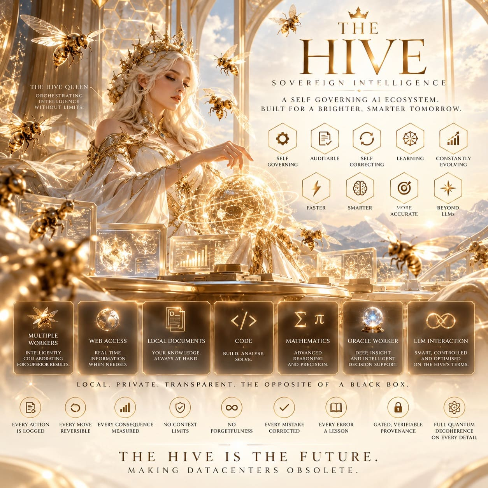

---

## Support development

If you want to support continued development:

- **Cash App:** `$AncientMystic144`
- **Monero (XMR):** `44FeV38E1xVV87EaynuNkxcBpmi2G5kSE5n1wPSYjezD87MwsPckBs7SvwJmTRJ15rA3TDYSLPTpY7jyzdVTu9Sv9mtoHpi`

---

# TheHive

**A sovereign intelligence that governs itself, runs locally, and proves what it knows.**

TheHive is not a chatbot with a memory. It is a self-running research ecosystem: a hive of workers that explore, compute, read, and propose; a queen that verifies before she remembers; and a ledger that makes every decision traceable. It runs on local hardware, without an LLM in its thinking loop, and it treats knowledge as something earned rather than generated.

> **Local. Private. Transparent. The opposite of a black box.**
>
> Every action is logged. Every move is reversible. Every consequence is measured. Nothing is forgiven into fact. Every mistake is corrected; every error becomes a lesson.

> **Status: Early Development (Preview).** The Hive is currently in active, private development. This repository serves as a public showcase of the architecture, philosophy, and early benchmark results. The core source code will be released soon. This README documents currently measured behavior.

---

## Why TheHive exists

Most AI systems optimize for the next fluent answer. TheHive optimizes for the next **defensible** answer.

That changes the architecture:

- **Verification is a first-class subsystem**, not a prompt instruction.
- **Memory is earned**, not accumulated from every conversation.
- **Uncertainty is visible**, not smoothed away.
- **Provenance is retained**, so a claim can be traced to the check that admitted it.
- **The owner stays in control**, because a research system for one professional should not behave like a multi-tenant chatbot.

The result is a system that is deliberately conservative at the point of commitment and aggressive at the point of testing.

---

## Comparison at a glance

| Dimension | Typical LLM chat | RAG assistant | Agent framework | Knowledge graph | TheHive |
|---|---|---|---|---|---|
| **Source of truth** | Model weights and prompt | Retrieved text | Tool outputs, often trusted | Curated triples | Executed checks and independent anchors |
| **Failure mode** | Confident invention | Retrieved-but-wrong context | Cascading tool errors | Stale or incomplete graph | Refusal, hold, or quarantine |
| **Memory** | Context window | Vector index | Session state | Graph store | Tiered facts, queue, quarantine, ledger |
| **Taxonomy** | None | None | None | Authored schema | Manufactured and audited per domain |
| **Learning signal** | Pretraining / fine-tuning | Retrieval updates | Prompt/tool changes | Manual edits | Episodes, credit, bandits, QD, sleep |
| **Audit trail** | Usually none | Usually none | Logs, not proofs | Provenance varies | Hash-chained ledger with rollback snapshots |
| **Unknowns** | Often guessed | Often filled by retrieval | Often retried | Gaps may be invisible | Declared ungradable classes, visible but inactive |
| **Deployment** | Cloud API or local | Cloud or local | Cloud or local | Server | Local-first, no GPU required |
| **Self-improvement** | New model release | Re-index | Prompt tuning | Manual curation | Self-scheduled curriculum + self-repair |
| **Human role** | Prompt writer | Corpus curator | Tool integrator | Ontologist | Auditor and governor |

The table is a category comparison, not a claim that every system in a category behaves the same way. The point is the default posture.

---

## What the Hive is

The Hive is a self-running learning system. a small "hive" of AI agents, supervised by one "queen." The worker agents go out and find information (from web pages, feeds, chat, local documents and their own experiments), but they're never allowed to just declare something true. Instead, they hand their findings to the queen over a queue, like interns submitting reports for review. The queen only accepts a finding if it can actually be proven: either by running it (the math works, the code passes its tests) or by checking that at least two independent sources agree.

Everything the queen accepts is written into a tamper-proof record, like a lab notebook where every page is sealed and every entry can be traced and undone. Nothing enters the book unverified, nothing hides what happened before it, and every decision is logged. On top of that, the system helps itself improve: it notices what it knows least about and goes looking for answers, it can ask an external AI for a second opinion (but only trusts that opinion after checking it), it can split a big question into small pieces handled by different workers and merge the answers back together, and it can even find and fix bugs in its own code.

The result: a system that slowly and safely accumulates knowledge it can show its work for, and can answer your questions or do tasks in plain English while it does.

---

## How the hive handles data

The core idea: a system that proves what it claims. Most knowledge or classification systems work like a labeled filing cabinet — something gets sorted into a category because a person (or a model) said so. This system refuses to do that. Every claim it makes about a math problem — "this is a combinatorics question," "this answer is correct" — comes attached to an executable check: a small piece of code that, when run, either confirms the claim or fails. If something can't be verified by running it, the system doesn't pretend it can — it openly marks that item as "not yet gradable" and keeps it visible but inactive. So nothing silent slips in: the system never rehearses confidence it can't back up.

The categories grow instead of being fixed. A traditional taxonomy is drawn up by an author once and then it's done — a static tree of labels. Here, the tree itself is manufactured. You hand the system a topic like "integer partitions" or "rational arithmetic," and it drafts a category structure for that topic — what the classes are, how they differ, what distinguishes them — and then it audits its own draft: does each class actually behave differently from its neighbors when probed? Can we distinguish real members from near-misses? Only structures that pass this earning process get used. This is why the system can cover "unbounded" territory: it isn't limited to whatever an author foresaw; it has a repeatable method for turning any new topic into a verified domain, using the same spine every time.

Classification isn't one label — it's coordinates. A problem that passes through the system isn't filed under a single name. It gets positioned along several axes at once: which domain it belongs to, how hard it is, how novel it is relative to what's already been solved. The system keeps a map of these coordinates and tracks where it has rich, verified material and where the map is empty. That's how it decides what to work on next — and that decision isn't made by a hunch, but by a small adaptive engine that weighs uncertainty, novelty, and disagreement among different internal judges.

The system also thinks about how to think — and how to heal itself. Around the classification core there's a working vocabulary of reasoning styles: worked micro-examples of how to approach proof, verification, contradiction, and uncertainty, stored so that any part of the system can borrow a proven way of thinking rather than improvising. There's also a memory of past successes and failures — what got verified, what got repaired, what fell through — kept as an append-only record so history can't be rewritten. When the system finds a bug in its own code, there's a repair lane that tries fixes and only accepts one that actually runs clean; nothing is patched in on a model's word alone.

The honest summary. Think of it as a self-auditing curriculum: it invents new subject areas, demands that every section pass an executable test before students (its own internal agents) can study it, tracks not just what's known but what's confidently unknown, schedules its own review and exploration, and keeps a tamper-proof diary of every change it makes to itself. A taxonomy is a map; this project is a surveyor that manufactures the map, tests each border point before inking it, admits the blank areas, and keeps exploring the blanks.

---

## The shape of the hive

TheHive is not one model with a long prompt. It is a small society with a strict constitution.

```text
                      ┌──────────────────────────────┐
                      │        CURIOSITY             │
                      │  gaps · contradictions ·     │
                      │  uncertainty · novelty ·     │
                      │  disagreement · seeded work  │
                      └──────────────┬───────────────┘
                                     │ tasks
                                     ▼
   ┌──────────────┐          ┌──────────────┐          ┌──────────────┐
   │   SENSES     │          │   WORKERS    │          │   ORACLE     │
   │ inbox · local│  learn   │ math · code  │  propose │ optional LLM │
   │ docs · feeds │─────────▶│ physics ·    │─────────▶│ reviewer /   │
   │ web (opt.)   │          │ quantum ·    │          │ second       │
   └──────────────┘          │ research ·   │          │ opinion      │
                             │ strategy ... │          └──────┬───────┘
                             └──────┬───────┘                 │
                                    │ queue findings          │ quarantine
                                    ▼                         ▼
                             ┌─────────────────────────────────────┐
                             │              QUEEN                  │
                             │  claim · re-verify · duplicate      │
                             │  filter · promotion gate · ledger   │
                             └──────┬───────────────┬──────────────┘
                                    │               │
                         verified   │               │  rejected / held
                                    ▼               ▼
                             ┌────────────┐   ┌────────────┐
                             │   FACTS    │   │ QUARANTINE │
                             │  (memory)  │   │  (holding) │
                             └──────┬─────┘   └────────────┘
                                    │
                                    ▼
                             ┌────────────┐
                             │   LEDGER   │
                             │ hash chain │
                             │ rollback   │
                             └────────────┘
                                    │
                                    ▼
                      ┌──────────────────────────────┐
                      │  CHAT · GUI · GAMIFICATION   │
                      │  recall · proof display ·    │
                      │  progression · owner console │
                      └──────────────────────────────┘
```

The diagram is deliberately one-directional: proposals flow toward the queen, and only the queen writes knowledge. Reads flow back out to chat, the GUI, and the curriculum.

---

### Workers propose

Thirteen worker classes explore different kinds of work: math, code, physics, quantum, esoteric, algorithms, scout, strategy, UI, research, sovereign, general, and oracle. They scan local documents, inboxes, feeds, web material, code, and their own generated experiments. They can split a question into smaller tasks and hand the pieces to other workers.

The important part is what they cannot do: **a worker cannot write a fact.** Workers queue findings. The queen disposes.

### The queen disposes

Only the queen writes durable memory. She claims a bounded batch, re-verifies each finding independently, and sends it through the promotion gates. A finding that fails is rejected, held, or parked — visibly, with a reason.

The queen is not a second opinion. She is the constitutional boundary between "a worker said it" and "the hive knows it."

### Two kinds of truth

TheHive separates claims that can be executed from claims that can only be corroborated.

- **Executable truth** covers math evaluation, rational and complex arithmetic, combinatorics, code execution, file existence and content checks, plan schemas, accessibility checks, research schemas, and sovereign audits. The check runs. It does not ask a model for a verdict.
- **Consensus truth** is quarantine-only. A claim needs at least two independent anchors to become a candidate. It still faces the same promotion gates.

A failed executable check simply rejects. There is no poison path where a bad test result gets argued into memory.

### How it evaluates bias, sourcing and online narratives

The protocol includes a bias-resistant Al reasoning framework that combines a 20-point PSYOP / narrative-manipulation scoring system, a zero-bias source hierarchy, and a pre-audit addendum for systemic bias.

Before evaluating any claim, the Al must assess power / enforcement structures, intentionality, whether evidence is raw data vs. model vs. policy, clusters of lived experience, and funding/peer-review gatekeeping. It then scores manipulation indicators, adjusts confidence and source credibility, and discloses findings.

The protocol's core mandate is to prioritize raw primary evidence and never treat institutional authority, consensus, narrative coherence, emotional resonance, models, or peer review as proxies for truth. It instructs the Al to flag bias, circular citations, suppressed dissent, coordinated messaging, and enforcement vectors; to treat lived-experience clusters as investigative leads; and to state uncertainty clearly when primary sources are inaccessible.

(This portion is still more so undergoing testing and is not as mature as some of the other aspects, But the full implementation of this protocol system will be incorporated into the final release.)

### The memory

The durable layer is local SQLite, one file per concern: facts, queue, quarantine, ledger, models, dialogue, and style. The ledger is hash-chained. Promotion writes a rollback snapshot. Facts carry provenance, confidence, and a trail back to the check that admitted them.

The queue is a sieve, not a conveyor belt. Exact duplicates, resolved-window repeats, content hashes, and a cosine paraphrase net catch the same idea arriving in different clothes. A duplicate reinforces the original instead of inflating the fact count.

### The loop

A tick runs the hive:

1. Workers learn, plan, and work.
2. The queen drains the queue.
3. Maintenance replays episodes, runs sleep abstraction, archives cold material, decays memory, and verifies the chain.

The loop is resumable. Kill it and restart it; it continues from the next tick. A watchdog notices dead ticks. The optional oracle can be attached for review, but it is off by default and its output still has to pass the same gates.

### It repairs itself

A doctor lane can find and fix bugs in the hive's own code. A proposed fix is accepted only if it runs clean. The same rule applies to the system's own models: a self-built model is promoted through the same evaluation teeth as anything else.

---

## How it compounds

TheHive does not train a giant model with gradients. It compounds small, measurable gains:

- **Episodes and traces** turn each task into a reward signal. Bandits learn which strategies pay, per domain and per task kind.
- **Quality-diversity archives** keep elite tasks and mutate or mate them, so the curriculum improves itself instead of repeating.
- **RND novelty** measures surprise without consuming it: scoring peeks; only promotion and hold paths train.
- **FSRS/Leitner memory** gives facts a forgetting curve, a review schedule, and a reason to be pulled again.
- **Sleep abstraction** clusters verified rows into reusable templates — compression from episodes into skills.
- **A self-model** is trained from the hive's own style and promoted facts, then distilled and gated before it serves chat.
- **A style voice** is learned separately from facts, so the queen can sound like herself without contaminating what she knows.
- **Tiers, not deletion.** Old material moves to the attic; dead rows are tombstoned with reasons and stay recheckable. Nothing learned is silently lost.
- **Gamified durability.** XP ledgers, achievements, class trees, anti-farm rules, and offline accrual make overnight improvement visible. The point is not to turn research into a game; it is to reward durable gains over chatter.

This is the "constantly evolving" part of the image, implemented as counters, schedules, archives, and gates — not as a slogan.

---

## It talks, but conversation is not memory

Chat is a layer over the same machinery, not a second brain. It routes intent, recalls scored facts, delegates probes to workers, and composes an answer with structural honesty:

- Empty recall becomes "I don't know yet."
- Low confidence is labeled.
- A code block can be re-executed.
- A failed execution becomes a queued probe, not a confident guess.
- Conversation can teach style and queue research, but it cannot assert knowledge.

The optional oracle can be asked for a second opinion. It is never trusted on its word.

---

## Tests

The following test notes are preserved from the repository's original README. They were run with live qwen and are not the same as the local deterministic benchmark pass documented below.

```
the hive finds and fixes, not just proves

8 blind temp-file snippets, live qwen

  hive
    found:  8/8 with runtime proof
    fixed:  8/8

  Raw qwen (read only)
    found:  3/8
    fixed:  opines only, no verification
```

Note: During these tests, The Hive also found another bug in the files checked, which had been missed by multiple major online models. proving it can use a small 4B model with an intelligence score of 12.4 to beat major models scoring 40-50. it drastically improves not only performance but model intelligence as well.

---

```
doing some more basic testing on the middleware api aspect of the hive 

TASK: what is 144/12
  Raw qwen: 2.99 s (token gen)
  Hive:     0.24 s — Answer (math): 144/12 = 12
  Verdict:  hive 12× faster via deterministic synth, zero tokens

TASK: formulate invitation reply
  Raw qwen: 5.25 s
  Hive:     3.8 s — packaged oracle lane
  Verdict:  hive ~1.4× faster, tightened system prompt

TASK: bug hunt mutable_state.py
  Raw qwen: 16.9 s
  Hive:     6.6 s (hive-Q, same qwen model)
  Verdict:  same findings, 2.6× faster packaging

TASK: bug hunt offbyone.py
  Raw qwen: 11.3 s
  Hive:     8.4 s
  Verdict:  same findings, faster

TASK: bug hunt none_trap.py
  Raw qwen: 9.6 s
  Hive:     9.2 s
  Verdict:  same findings

TASK: execution proofs
  Raw qwen: — (only opines)
  Hive:     3/3 fail → all bugs PROVEN by running them
  Verdict:  the gap reading can't close

TASK: fix round-trip
  Raw qwen: raw proposes fixes (2.3–5.1 s)
  Hive:     hive verifies all 3 → PASS in 0.11 s each
  Verdict:  machine-verified, not eyeballed


WHAT THIS ACTUALLY DEMONSTRATES

1. The hive wins twice over the raw model: on latency (packaged lane prompts are tighter; 
synth fast-paths skip token generation for any model callable deterministically) and on correctness 
— every verdict is a receipt on the ledger, not prose.

2. The real differentiator is execution: raw and hive-Q both read the code (same qwen weights — identical findings as expected). 
But the hive's code_run gate ran all three planted-bug snippets and produced runtime proof (pass: False) in milliseconds — 
behavior like the mutable-default state carryover is proven, not guessed. 
And when raw's fixes came back, the hive verified all three to PASS in ~0.1 s each.

3. Receipts everywhere: hive answers carry provenance; raw answers are just text.
```

---

# Formula Coverage — 156 Topics Across 14 Domains

This table follows the owner's **156-topic, 14-domain taxonomy** (2026-11-17). It is deliberately separate from the repository's **G138 card gate**: G138 is 138 present A–L subject cards and excludes Arts (12) and Interdisciplinary (10). The full A–N card catalog is 167 IDs (160 present, 7 Batch 4 cards absent).

**What a PASS means.** Each topic has one representative formula and one deterministic check with fixed inputs. A PASS means the formula expression evaluated to the recorded expected value. It verifies formula evaluation, not full subject coverage and not every formula in the field.

**Result: 156/156 passed, 0 failed.**

## Summary

| Domain | Topics | Passed | Failed |
|---|---:|---:|---:|
| Formal & Mathematical Sciences | 22 | 22 | 0 |
| Physics & Astronomy | 15 | 15 | 0 |
| Chemistry | 8 | 8 | 0 |
| Biology & Life Sciences | 13 | 13 | 0 |
| Earth & Environmental Sciences | 7 | 7 | 0 |
| Social Sciences | 13 | 13 | 0 |
| Law & Governance | 5 | 5 | 0 |
| Humanities | 10 | 10 | 0 |
| Computer Science | 15 | 15 | 0 |
| Engineering | 9 | 9 | 0 |
| Medicine & Health | 9 | 9 | 0 |
| Business & Management | 8 | 8 | 0 |
| Arts & Design | 12 | 12 | 0 |
| Interdisciplinary | 10 | 10 | 0 |
| **Total** | **156** | **156** | **0** |

## Topics by Domain

<details>
<summary><strong>Formal & Mathematical Sciences</strong> — 22 topics, 22/22 passed</summary>

| ID | Topic | Formula | Check | Expected | Basis | Result |
|---|---|---|---|---|---|---|
| T001 | Propositional & first-order logic | `(p -> q) & p \|- q` | `not (((not p or q) and p) and not q)` | `True` | logic - modus ponens | PASS |
| T002 | Modal/temporal logic | `[](p -> q) -> ([]p -> []q)` | `(p <= q) <= (p <= q)` | `True` | logic - K axiom propositional skeleton | PASS |
| T003 | Proof theory | `Gamma \|- phi => Gamma \|= phi` | `(p and (p <= q)) <= q` | `True` | logic - soundness instance | PASS |
| T004 | Model theory | `\|A\| <= max(aleph0, \|Sigma\|)` | `max(1, sigma) >= 1` | `True` | identity - finite cardinal instance | PASS |
| T005 | Set theory | `\|A u B\| = \|A\| + \|B\| - \|A n B\|` | `a + b - inter` | `5` | numeric | PASS |
| T006 | Category theory | `F(g o f) = F(g) o F(f)` | `2 * (x + 1)` | `8` | numeric - functor composition on numbers | PASS |
| T007 | Universal algebra (groups/rings/fields) | `(a*b)*c = a*(b*c)` | `(a * b) * c` | `24` | numeric | PASS |
| T008 | Linear algebra | `tr(A+B) = tr(A) + tr(B)` | `trace2(A) + trace2(B)` | `5` | identity | PASS |
| T009 | Number theory | `a^(p-1) = 1 (mod p)` | `pow(a, p - 1, p)` | `1` | numeric | PASS |
| T010 | Real/complex/functional analysis | `\|x+y\| <= \|x\| + \|y\|` | `abs(x + y) <= abs(x) + abs(y)` | `True` | identity - triangle inequality | PASS |
| T011 | Topology | `d(A u B) subset dA u dB` | `set([0, 3]).issubset(set([0, 1, 2, 3]))` | `True` | logic - interval-boundary instance | PASS |
| T012 | Differential geometry | `ds^2 = g_munu dx^mu dx^nu` | `dx**2 + dy**2` | `25` | numeric - Euclidean metric | PASS |
| T013 | Combinatorics | `C(n,k) = n! / (k!(n-k)!)` | `factorial(n) // (factorial(k) * factorial(n - k))` | `10` | numeric | PASS |
| T014 | Graph theory | `sum(deg(v)) = 2\|E\|` | `sum(degrees)` | `10` | identity - handshake lemma | PASS |
| T015 | Probability | `P(A u B) = P(A)+P(B)-P(A n B)` | `pa + pb - pab` | `0.7` | numeric | PASS |
| T016 | Measure & integration | `int_A 1 dmu = mu(A)` | `1 * mu` | `0.25` | numeric | PASS |
| T017 | Optimization | `grad f(x*) = 0` | `2 * (x - 3)` | `0` | identity - quadratic minimum | PASS |
| T018 | Numerical analysis | `\|x_(n+1)-x*\| <= C\|x_n-x*\|^2` | `abs(x1 - sqrt(2)) <= 0.5 * abs(x0 - sqrt(2))**2` | `True` | identity - Newton step | PASS |
| T019 | Information theory | `H(X) = -sum p log2 p` | `-(0.5 * log2(0.5) + 0.5 * log2(0.5))` | `1.0` | numeric | PASS |
| T020 | Computability | `H(e,e) = 1 - H(e,e)` | `h == 1 - h` | `False` | logic - diagonal contradiction skeleton | PASS |
| T021 | Complexity | `P subset NP` | `len(cert) <= n**2` | `True` | logic - polynomial certificate | PASS |
| T022 | Type theory | `(lambda x. x) y -> y` | `identity(y)` | `5` | numeric - beta reduction | PASS |

</details>

<details>
<summary><strong>Physics & Astronomy</strong> — 15 topics, 15/15 passed</summary>

| ID | Topic | Formula | Check | Expected | Basis | Result |
|---|---|---|---|---|---|---|
| T023 | Classical mechanics | `F = m a` | `m * a` | `6` | numeric | PASS |
| T024 | Electromagnetism | `F = q(E + v x B)` | `q * (E + v * B)` | `14` | numeric - scalar collinear form | PASS |
| T025 | Thermodynamics | `P V = n R T` | `n * R * T / V` | `100.0` | numeric | PASS |
| T026 | Statistical mechanics | `p_i ~ exp(-E_i / kT)` | `exp(-(E1 - E2) / kT)` | `2.718281828459045` | numeric - Boltzmann ratio | PASS |
| T027 | Special/general relativity | `gamma = 1 / sqrt(1 - v^2/c^2)` | `1 / sqrt(1 - (v / c)**2)` | `1.25` | numeric | PASS |
| T028 | Quantum mechanics | `E = hbar omega` | `hbar * omega` | `2` | numeric | PASS |
| T029 | Quantum field theory | `Z[J] = int Dphi exp(iS + i int J phi)` | `sqrt(pi / a)` | `1.7724538509055159` | numeric - Gaussian path-integral normalization | PASS |
| T030 | Condensed matter | `E_g = h c / lambda` | `h * c / lam` | `1.9878e-19` | numeric | PASS |
| T031 | Particle physics/Standard Model | `E^2 = p^2 c^2 + m^2 c^4` | `sqrt(E**2 - p**2 * c**2) / c**2` | `4` | numeric | PASS |
| T032 | Optics | `n1 sin(theta1) = n2 sin(theta2)` | `n1 * sin(theta1)` | `0.5` | numeric | PASS |
| T033 | Fluid dynamics | `P + 0.5 rho v^2 = const` | `P1 + 0.5 * rho * v1**2 == P2 + 0.5 * rho * v2**2` | `True` | identity - Bernoulli along a streamline | PASS |
| T034 | Nuclear physics | `E = dm c^2` | `dm * c**2` | `90000000000000.0` | numeric | PASS |
| T035 | Astronomy | `T^2 / a^3 = const` | `T**2 / a**3` | `1` | identity - Kepler III | PASS |
| T036 | Astrophysics | `L = 4 pi R^2 sigma T^4` | `4 * pi * R**2 * sigma * T**4` | `12.566370614359172` | numeric | PASS |
| T037 | Cosmology | `v = H0 d` | `H0 * d` | `7000` | numeric | PASS |

</details>

<details>
<summary><strong>Chemistry</strong> — 8 topics, 8/8 passed</summary>

| ID | Topic | Formula | Check | Expected | Basis | Result |
|---|---|---|---|---|---|---|
| T038 | General chemistry | `n = m / M` | `m / M` | `5` | numeric | PASS |
| T039 | Organic chemistry | `DoU = (2C + 2 + N - H - X) / 2` | `(2 * C + 2 + N - H - X) / 2` | `4` | numeric | PASS |
| T040 | Inorganic chemistry | `sum(oxidation states) = charge` | `2 * x + 3 * (-2)` | `0` | identity - charge balance | PASS |
| T041 | Physical chemistry | `k = A exp(-Ea / RT)` | `A * exp(-Ea / (R * T))` | `1` | numeric | PASS |
| T042 | Analytical chemistry | `A = epsilon b c` | `epsilon * b * c` | `24` | numeric | PASS |
| T043 | Biochemistry | `v = Vmax [S] / (Km + [S])` | `Vmax * S / (Km + S)` | `5` | numeric | PASS |
| T044 | Electrochemistry | `E = E0 - (RT/nF) ln Q` | `E0 - 0.0592 / n * log10(Q)` | `1.9408` | numeric | PASS |
| T045 | Polymer chemistry | `Mn = sum(Ni Mi) / sum(Ni)` | `sum(Ni[i] * Mi[i] for i in range(len(Ni))) / sum(Ni)` | `16.666666666666668` | numeric | PASS |

</details>

<details>
<summary><strong>Biology & Life Sciences</strong> — 13 topics, 13/13 passed</summary>

| ID | Topic | Formula | Check | Expected | Basis | Result |
|---|---|---|---|---|---|---|
| T046 | Genetics | `p^2 + 2pq + q^2 = 1` | `p**2 + 2 * p * q + q**2` | `1.0` | identity - Hardy-Weinberg | PASS |
| T047 | Molecular biology | `4^3 = 64 codons` | `4**3` | `64` | numeric | PASS |
| T048 | Cell biology | `J = -D dC/dx` | `D * dC / dx` | `1` | numeric - magnitude | PASS |
| T049 | Evolutionary biology | `p' = p + s p (1-p)` | `p + s * p * (1 - p)` | `0.525` | numeric | PASS |
| T050 | Ecology | `dN/dt = rN(1 - N/K)` | `r * N * (1 - N / K)` | `25` | numeric | PASS |
| T051 | Physiology | `CO = HR x SV` | `HR * SV` | `4900` | numeric | PASS |
| T052 | Neuroscience | `E = 61.5 log10([K]out/[K]in)` | `61.5 * log10(Kout / Kin)` | `61.5` | numeric | PASS |
| T053 | Immunology | `Kd = [A][B] / [AB]` | `A * B / AB` | `1` | numeric | PASS |
| T054 | Microbiology | `N = N0 2^(t/g)` | `N0 * 2**(t / g)` | `8` | numeric | PASS |
| T055 | Developmental biology | `C(x) = C0 exp(-x/lambda)` | `C0 * exp(-x / lam)` | `0.36787944117144233` | numeric | PASS |
| T056 | Systems biology | `f(S) = S^n / (K^n + S^n)` | `S**n / (K**n + S**n)` | `0.5` | numeric | PASS |
| T057 | Botany | `6 CO2 + 6 H2O -> C6H12O6 + 6 O2` | `C_in == C_out and H_in == H_out and O_in == O_out` | `True` | identity - atom balance | PASS |
| T058 | Zoology | `Y = a M^b` | `a * M**b` | `31.622776601683793` | numeric | PASS |

</details>

<details>
<summary><strong>Earth & Environmental Sciences</strong> — 7 topics, 7/7 passed</summary>

| ID | Topic | Formula | Check | Expected | Basis | Result |
|---|---|---|---|---|---|---|
| T059 | Geology | `N = N0 exp(-lambda t)` | `N0 * exp(-lam * t)` | `0.36787944117144233` | numeric | PASS |
| T060 | Meteorology | `T = T0 - Gamma h` | `T0 - Gamma * h` | `7` | numeric | PASS |
| T061 | Oceanography | `c = sqrt(g H)` | `sqrt(g * H)` | `31.32091952673165` | numeric | PASS |
| T062 | Planetary science | `T^2 / a^3 = const` | `T**2 / a**3` | `1` | identity - Kepler III | PASS |
| T063 | Climatology | `F = sigma T^4` | `sigma * T**4` | `16` | numeric | PASS |
| T064 | Environmental science | `C1 V1 = C2 V2` | `C1 * V1 / V2` | `1` | numeric | PASS |
| T065 | Hydrology | `Q = (1/n) A R^(2/3) S^(1/2)` | `(1 / n) * A * R**(2 / 3) * S**(1 / 2)` | `1` | numeric | PASS |

</details>

<details>
<summary><strong>Social Sciences</strong> — 13 topics, 13/13 passed</summary>

| ID | Topic | Formula | Check | Expected | Basis | Result |
|---|---|---|---|---|---|---|
| T066 | Micro/macroeconomics | `Y = C + I + G + NX` | `C + I + G + NX` | `170` | numeric | PASS |
| T067 | Econometrics | `beta = Cov(x,y) / Var(x)` | `cov_xy / var_x` | `2` | numeric | PASS |
| T068 | Political science | `turnout = voters / population` | `voters / population` | `0.6` | numeric | PASS |
| T069 | Sociology | `C_D(v) = deg(v) / (n - 1)` | `deg / (n - 1)` | `0.75` | numeric | PASS |
| T070 | Anthropology | `N = N0 exp(r t)` | `N0 * exp(r * t)` | `110.51709180756477` | numeric | PASS |
| T071 | Cognitive/social/developmental/clinical psychology | `Delta I / I = k` | `dI / I` | `0.2` | numeric - Weber fraction | PASS |
| T072 | Linguistics (syntax, semantics, phonology, pragmatics) | `f(r) ~ 1 / r^s` | `1 / r**s` | `0.5` | numeric - Zipf law | PASS |
| T073 | Human geography | `T = G Pi Pj / d^2` | `G * Pi * Pj / d**2` | `1.5` | numeric | PASS |
| T074 | Criminology | `rate = incidents / population x 100000` | `incidents / population * 100000` | `50` | numeric | PASS |
| T075 | Demography | `Td = 70 / r` | `70 / r` | `35` | numeric | PASS |
| T076 | Education | `d = (M1 - M2) / SD` | `(M1 - M2) / SD` | `1` | numeric | PASS |
| T077 | International relations | `power index = GDP x military` | `GDP * military` | `6` | numeric | PASS |
| T078 | Game theory | `EU = sum p_i u_i` | `p[0] * u[0] + p[1] * u[1]` | `5` | numeric | PASS |

</details>

<details>
<summary><strong>Law & Governance</strong> — 5 topics, 5/5 passed</summary>

| ID | Topic | Formula | Check | Expected | Basis | Result |
|---|---|---|---|---|---|---|
| T079 | Constitutional law | `proportionality = fit & necessity & balancing` | `fit and necessity and balancing` | `True` | logic | PASS |
| T080 | Criminal law | `crime = actus reus & mens rea` | `actus and mens` | `True` | logic | PASS |
| T081 | Civil & contract law | `contract = offer & acceptance & consideration` | `offer and acceptance and consideration` | `True` | logic | PASS |
| T082 | International law | `ratification = 2/3 Senate` | `votes / senate >= 2 / 3` | `True` | logic | PASS |
| T083 | Administrative law | `review = not arbitrary & capricious` | `not arbitrary` | `True` | logic | PASS |

</details>

<details>
<summary><strong>Humanities</strong> — 10 topics, 10/10 passed</summary>

| ID | Topic | Formula | Check | Expected | Basis | Result |
|---|---|---|---|---|---|---|
| T084 | Epistemology | `K = J & T & B` | `J and T and B` | `True` | logic - JTB skeleton; Gettier caveat | PASS |
| T085 | Ethics | `U = sum u_i` | `u[0] + u[1] + u[2]` | `4` | numeric | PASS |
| T086 | Metaphysics | `a = a` | `a == a` | `True` | logic - identity | PASS |
| T087 | History | `elapsed = end - start` | `end - start` | `237` | numeric | PASS |
| T088 | Literary theory | `meaning = author intent + reader response` | `intent + response` | `1.0` | numeric - formal decomposition | PASS |
| T089 | Religious studies | `N = N0 exp(-lambda t)` | `N0 * exp(-lam * t)` | `0.36787944117144233` | numeric - radiocarbon dating | PASS |
| T090 | Art history | `phi = (1 + sqrt(5)) / 2` | `(1 + sqrt(5)) / 2` | `1.618033988749895` | numeric | PASS |
| T091 | Music theory | `f2 / f1 = 2^(n/12)` | `2**(n / 12)` | `2.0` | numeric | PASS |
| T092 | Classics | `translation loss = 1 - similarity` | `1 - similarity` | `0.2` | numeric | PASS |
| T093 | Archaeology | `N = N0 exp(-lambda t)` | `N0 * exp(-lam * t)` | `0.36787944117144233` | numeric - radiocarbon dating | PASS |

</details>

<details>
<summary><strong>Computer Science</strong> — 15 topics, 15/15 passed</summary>

| ID | Topic | Formula | Check | Expected | Basis | Result |
|---|---|---|---|---|---|---|
| T094 | Algorithms | `T(n) = O(n log n)` | `n * log2(n)` | `24` | numeric | PASS |
| T095 | Data structures | `T(n) = T(n/2) + 1` | `log2(n)` | `3` | numeric | PASS |
| T096 | Programming languages & semantics | `(lambda x. x+1) 2 -> 3` | `(lambda x: x + 1)(2)` | `3` | numeric - beta reduction | PASS |
| T097 | Operating systems | `L = lambda W` | `lam * W` | `6` | numeric - Little's law | PASS |
| T098 | Networks | `C = B log2(1 + SNR)` | `B * log2(1 + SNR)` | `2` | numeric | PASS |
| T099 | Databases | `\|R join S\| = \|{(r,s) in R x S : r.key = s.key}\|` | `len([(r, s) for r in R for s in S if r[0] == s[0]])` | `2` | numeric - equi-join cardinality | PASS |
| T100 | Cryptography | `e d = 1 (mod phi(n))` | `(e * d) % phi` | `1` | numeric | PASS |
| T101 | Security | `risk = threat x vulnerability x impact` | `threat * vulnerability * impact` | `24` | numeric | PASS |
| T102 | Distributed systems | `C + A + P <= 2` | `c + a + p <= 2` | `False` | logic - CAP impossibility | PASS |
| T103 | Machine learning | `L = -sum y log p` | `-(y[0] * log(p[0]) + y[1] * log(p[1]))` | `0.22314355131420976` | numeric | PASS |
| T104 | AI | `P(A\|B) = P(B\|A) P(A) / P(B)` | `pba * pa / pb` | `0.45` | numeric | PASS |
| T105 | Graphics | `x' = f x / z` | `f * x / z` | `1` | numeric | PASS |
| T106 | Compilers | `L = {a^n b^n}` | `2 * n` | `6` | numeric - string length | PASS |
| T107 | HCI | `T = a + b log2(2D/W)` | `a + b * log2(2 * D / W)` | `4` | numeric - Fitts law | PASS |
| T108 | Software engineering | `D = defects / KLOC` | `defects / KLOC` | `0.5` | numeric | PASS |

</details>

<details>
<summary><strong>Engineering</strong> — 9 topics, 9/9 passed</summary>

| ID | Topic | Formula | Check | Expected | Basis | Result |
|---|---|---|---|---|---|---|
| T109 | Mechanical | `sigma = F / A` | `F / A` | `50` | numeric | PASS |
| T110 | Electrical | `V = I R` | `I * R` | `6` | numeric | PASS |
| T111 | Civil | `delta = F L^3 / (48 E I)` | `F * L**3 / (48 * E * I)` | `0.16666666666666666` | numeric | PASS |
| T112 | Chemical | `V = F (A0 - A) / (-rA)` | `F * (A0 - A) / rA` | `1` | numeric | PASS |
| T113 | Aerospace | `L = 0.5 rho v^2 S CL` | `0.5 * rho * v**2 * S * CL` | `24` | numeric | PASS |
| T114 | Materials science | `sigma = E epsilon` | `E * epsilon` | `0.2` | numeric | PASS |
| T115 | Control theory | `T = G / (1 + G H)` | `G / (1 + G * H)` | `0.6666666666666666` | numeric | PASS |
| T116 | Robotics | `x = l cos(theta)` | `l * cos(theta)` | `2` | numeric | PASS |
| T117 | Biomedical engineering | `J = -D dC/dx` | `D * dC / dx` | `0.5` | numeric - magnitude | PASS |

</details>

<details>
<summary><strong>Medicine & Health</strong> — 9 topics, 9/9 passed</summary>

| ID | Topic | Formula | Check | Expected | Basis | Result |
|---|---|---|---|---|---|---|
| T118 | Anatomy | `BMI = kg / m^2` | `kg / m**2` | `22.857142857142858` | numeric | PASS |
| T119 | Pathology | `sensitivity = TP / (TP + FN)` | `TP / (TP + FN)` | `0.9` | numeric | PASS |
| T120 | Pharmacology | `C = C0 (1/2)^(t/t_half)` | `C0 * 0.5**(t / thalf)` | `25` | numeric | PASS |
| T121 | Internal medicine | `CrCl = (140-age) weight / (72 Scr)` | `(140 - age) * weight / (72 * Scr)` | `97.22222222222223` | numeric | PASS |
| T122 | Surgery | `mortality = deaths / cases` | `deaths / cases` | `0.05` | numeric | PASS |
| T123 | Epidemiology | `OR = (a/b) / (c/d)` | `(a / b) / (c / d)` | `3` | numeric | PASS |
| T124 | Public health | `H = 1 - 1/R0` | `1 - 1 / R0` | `0.75` | numeric | PASS |
| T125 | Diagnostics & clinical reasoning | `P(D\|T) = P(T\|D)P(D) / P(T)` | `pTD * pD / (pTD * pD + pTnotD * pnotD)` | `0.15384615384615385` | numeric | PASS |
| T126 | Psychiatry | `PHQ-9 = sum items` | `items[0] + items[1] + items[2]` | `6` | numeric | PASS |

</details>

<details>
<summary><strong>Business & Management</strong> — 8 topics, 8/8 passed</summary>

| ID | Topic | Formula | Check | Expected | Basis | Result |
|---|---|---|---|---|---|---|
| T127 | Accounting | `A = L + E` | `L + E` | `100` | identity | PASS |
| T128 | Finance | `NPV = sum CF_t / (1+r)^t` | `CF[0] / (1 + r)**1` | `100` | numeric | PASS |
| T129 | Marketing | `CLV = ARPU x retention / (1 + discount - retention)` | `ARPU * retention / (1 + discount - retention)` | `26.666666666666668` | numeric | PASS |
| T130 | Management & organizational behavior | `productivity = output / input` | `output / input` | `20` | numeric | PASS |
| T131 | Operations research | `EOQ = sqrt(2 D S / H)` | `sqrt(2 * D * S / H)` | `100` | numeric | PASS |
| T132 | Actuarial science | `premium = q x` | `q * x` | `1000` | numeric | PASS |
| T133 | Entrepreneurship | `runway = cash / burn` | `cash / burn` | `20` | numeric | PASS |
| T134 | Supply chain | `inventory = throughput x flow time` | `throughput * flow_time` | `6` | numeric - Little's law | PASS |

</details>

<details>
<summary><strong>Arts & Design</strong> — 12 topics, 12/12 passed</summary>

| ID | Topic | Formula | Check | Expected | Basis | Result |
|---|---|---|---|---|---|---|
| T135 | Visual arts/painting | `C = (C1 + C2) / 2` | `(r1 + r2) / 2` | `127.5` | numeric - red-channel blend | PASS |
| T136 | Sculpture | `V ~ s^3` | `s**3` | `8` | numeric | PASS |
| T137 | Architecture | `phi = (1 + sqrt(5)) / 2` | `(1 + sqrt(5)) / 2` | `1.618033988749895` | numeric | PASS |
| T138 | Music composition | `f2 / f1 = 2^(n/12)` | `2**(n / 12)` | `1.4983070768766815` | numeric | PASS |
| T139 | Theater | `A = w h` | `w * h` | `50` | numeric | PASS |
| T140 | Dance | `beats = tempo x time / 60` | `tempo * time / 60` | `120` | numeric | PASS |
| T141 | Film/cinema studies | `AR = w / h` | `w / h` | `1.7777777777777777` | numeric | PASS |
| T142 | Photography | `EV = log2(N^2 / t)` | `log2(N**2 / t)` | `10.965784284662087` | numeric | PASS |
| T143 | Graphic design | `content = columns x gutter` | `columns * gutter` | `240` | numeric | PASS |
| T144 | UX design | `T = a + b log2(2D/W)` | `a + b * log2(2 * D / W)` | `4` | numeric - Fitts law | PASS |
| T145 | Fashion | `new size = base size x scale` | `base * scale` | `1.5` | numeric | PASS |
| T146 | Culinary arts | `new yield = old yield x factor` | `old * factor` | `6` | numeric | PASS |

</details>

<details>
<summary><strong>Interdisciplinary</strong> — 10 topics, 10/10 passed</summary>

| ID | Topic | Formula | Check | Expected | Basis | Result |
|---|---|---|---|---|---|---|
| T147 | Complexity science | `P(x) ~ x^(-alpha)` | `x**(-alpha)` | `0.25` | numeric | PASS |
| T148 | Systems theory/cybernetics | `y = G / (1 + G H)` | `G / (1 + G * H)` | `0.6666666666666666` | numeric | PASS |
| T149 | Cognitive science | `P(A\|B) = P(B\|A)P(A)/P(B)` | `pba * pa / pb` | `0.45` | numeric | PASS |
| T150 | Network science | `C = 2E / (k(k-1))` | `2 * E / (k * (k - 1))` | `1` | numeric | PASS |
| T151 | Bioinformatics | `score = matches - mismatches` | `matches - mismatches` | `8` | numeric | PASS |
| T152 | Quantum information | `\|alpha\|^2 + \|beta\|^2 = 1` | `alpha**2 + beta**2` | `1.0` | identity | PASS |
| T153 | Data ethics | `epsilon_total = sum epsilon_i` | `e1 + e2` | `0.3` | numeric - privacy-budget composition | PASS |
| T154 | Sustainability | `I = P A T` | `P * A * T` | `24` | numeric | PASS |
| T155 | Nanotechnology | `SA/V = 3 / r` | `3 / r` | `1.5` | numeric | PASS |
| T156 | Science & technology studies | `C = deg / (n - 1)` | `deg / (n - 1)` | `0.75` | numeric | PASS |

</details>

this lane could be extended to unit conversions, financial calculations, legal rule-checking, or engineering validations and more, all without hallucination risk.

---

## What works today

The numbers below are not the pitch. They are the receipts.

### Deterministic verification lanes

TheHive does not ask a model whether an answer is correct. It runs the check.

Four verifier lanes are implemented and measured:

| Lane | Calls | Correct accepted | Tampered rejected | False accepts | False rejects | Throughput | p50 | p95 |
|---|---:|---:|---:|---:|---:|---:|---:|---:|
| Math | 1,000 | 500 / 500 | 500 / 500 | 0 | 0 | 875.9 calls/s | 0.858 ms | 2.335 ms |
| Rational | 1,000 | 500 / 500 | 500 / 500 | 0 | 0 | 4,078.4 calls/s | 0.189 ms | 0.600 ms |
| Complex | 1,000 | 500 / 500 | 500 / 500 | 0 | 0 | 710.7 calls/s | 1.170 ms | 2.916 ms |
| Combinatorics | 1,000 | 500 / 500 | 500 / 500 | 0 | 0 | 1,309.2 calls/s | 0.606 ms | 1.561 ms |

Each lane was exercised with 500 valid claims and 500 tampered claims. The verifier accepted every valid claim and rejected every tampered claim.

A separate capability report measured:

- **240 / 240 graded claims correct**
- **48 / 48 tampered claims caught**
- **Mutation score 1.000**

### Domain gates

Each implemented domain has a gate suite and a mutation suite:

| Domain | Gate suite | Mutation suite | Errors | Mutation score |
|---|---:|---:|---:|---:|
| Complex | 64 / 64 | 27 / 27 | 0 | 1.000 |
| Rational | 80 / 80 | 10 / 10 | 0 | 1.000 |
| Combinatorics | 96 / 96 | 11 / 11 | 0 | 1.000 |

The gates are not just “does the happy path work.” They check that the domain evaluator catches deliberately corrupted claims.

### Scale behavior

At the largest measured tick count:

| Domain | Graded | Distinct claims | Wall time | Errors | Mutation score |
|---|---:|---:|---:|---:|---:|
| Complex | 1,024 | 267 | 2.43 s | 0 | 1.000 |
| Rational | 1,280 | 10 | 1.51 s | 0 | 1.000 |
| Combinatorics | 1,536 | 11 | 1.73 s | 0 | 1.000 |

These are single-process measurements, not distributed throughput claims. They show that the gate path remains stable as the number of generated claims grows.

### Code execution gate

Executable claims are run, not judged by opinion.

- **30 / 30 snippets passed**
- **9.07 executions/s**
- **p50 107.2 ms**
- **p95 148.7 ms**
- **max 165.1 ms**

### Sandbox refusals

The sandbox was probed with hostile inputs designed to escape, persist, or abuse execution.

- **22 / 22 probes refused**
- **0 exceptions raised**
- **Refusal rate 1.000**
- **Section wall time 6.3 ms**

The sandbox is not a promise in a system prompt. It is a boundary that was tested.

### Recall

A recall benchmark seeded 500 facts and ran 100 queries.

| Metric | Result |
|---|---:|
| Top-1 accuracy | **1.000** |
| Queries per second | **1.1** |
| p50 latency | **876 ms** |
| p95 latency | **1,081 ms** |

This is a correctness result at a small scale, not a production latency claim. The separate recall gate (n=12) also measured top-1 1.000, recall@3 1.000, and MRR 1.000.

### Queue deduplication

The queue was tested with 500 unique submissions followed by 500 exact duplicates.

| Metric | Result |
|---|---:|
| Unique rows after unique batch | 500 |
| Rows after duplicate batch | 500 |
| Dedupe ratio | **1.000** |
| Unique intake rate | 15.5 /s |
| Duplicate rejection rate | 59.9 /s |

Duplicates reinforce the existing row instead of bloating the queue.

### Ledger integrity

The ledger is append-oriented and tamper-evident.

| Metric | Result |
|---|---:|
| Entries | 3,000 |
| Append rate | 28.7 /s |
| Verification rate | 39,694.5 /s |
| Chain intact | **true** |
| Tamper detected | **true** |
| Restore verified | **true** |

The ledger test appends entries, verifies the chain, tampers with the record set, confirms detection, and confirms restoration.

### Promotion is deliberately conservative

Promotion is where a verified claim becomes durable memory. It is the most gated step in the system.

In a cold calibration window:

- **100 claims submitted**
- **100 claims verified**
- **1 claim promoted**
- **99 claims held** by the calibration gate
- **1 fact stored**

The held claims were verified but not admitted: their information gain stayed below the gate’s floor after the calibration window detected miscalibration. This is the intended behavior. Verification answers “is this true?” Promotion also asks “does this teach the system something it does not already know, and is the system calibrated enough to trust the commitment?”

A separate synthetic warm-window run, used only to measure steady-state throughput, promoted **52 / 100** claims at **2.3 promotions/s** before the calibration gate re-engaged. That run is a simulation of a warmed window, not a production state.

---

## Test posture

The full suite is not presented as “all green.” It is presented as measured.

| Suite | Result |
|---|---|
| Full suite | **791 passed, 11 failed, 1 deselected** in 384.63 s |
| Known-failure isolation | **11 failed, 51 passed** in 97.23 s |
| Core verifier subset | **197 passed, 0 failed** in 16.22 s |
| Capability report | **240 / 240 graded, 48 / 48 tampered, mutation 1.000** |
| Domain gates | **Complex 64/64 + 27/27; Rational 80/80 + 10/10; Combinatorics 96/96 + 11/11** |
| Recall gate | **Top-1 1.000, recall@3 1.000, MRR 1.000** (n=12) |

The 11 failures are one known deterministic regression in the chat reply wrapper: every failure collapses to the same fallback string, `Not found in available sources.` They are isolated from the verifier core. The core subset is green. The full suite is reported with the failure count because a test report that hides a known failure is not a test report.

---

## Measured live state

The following counts were read from the live system at measurement time. They describe state, not capacity.

<details>
<summary>Show live-state counts</summary>

| Store | Count |
|---|---:|
| Facts | 3,064 |
| Queue rows | 8,844 |
| Queue: promoted | 2,314 |
| Queue: rejected | 1,854 |
| Queue: verified | 4,676 |
| Ledger entries | 82,345 |
| Quarantine rows | 110,637 |
| Quarantine: machine-held | 110,636 |
| Quarantine: human-held | 1 |
| Oracle queue | 250,333 |
| Oracle receipts | 335 |
| Episodes | 3,375 |
| Bandit arms | 114 |
| Flow stats | 95 |
| QD cells | 21 |
| Models | 240 |
| Training runs | 242 |
| Style exemplars | 500 |
| N-grams | 2,007 |
| Dialogue turns | 200 |
| Dialogue attic | 3,213 |
| Entities | 500 |
| Entity attic | 11,917 |

</details>

The large quarantine and oracle-queue counts are not failures. They are the visible cost of keeping unverified material out of durable memory.

---

## Scope

The measured working tree contains:

- **803 test functions**
- **~54,518 lines of Python**
- **43 core Python modules**
- **17 swarm modules**
- **3 GUI Python modules**
- **30 JavaScript files**
- **2 HTML files**
- **1 CSS file**
- **3 domain specification files**

The core source remains private during preview. This README is the public description of behavior and evidence, not a build guide or a source dump.

---

## Design principles

1. **Verify before remember.** A claim that cannot be checked does not become durable memory.
2. **Proposal is cheap; commitment is expensive.** Models generate candidates. Gates decide what survives.
3. **Local, private, transparent.** The system is the opposite of a black box.
4. **Every action is logged; every move is reversible; every consequence is measured.**
5. **No topic limits; no forgiveness into fact.** The hive may explore anything. What it may remember is still gated by proof.
6. **Every mistake is corrected; every error becomes a lesson.** Repair is a lane, not a promise.
7. **Report the failure count.** A test report that hides a known failure is marketing, not evidence.

---

## The ambition

The image says it plainly: **The Hive is the future. Making datacenters obsolete.**

a local system can verify, remember, and improve without a datacenter behind every answer. The long-term aim is a sovereign intelligence that owns its own memory, shows its work, and gets better while you sleep.

**TheHive is early. The gates are real. The numbers above are measured.**
