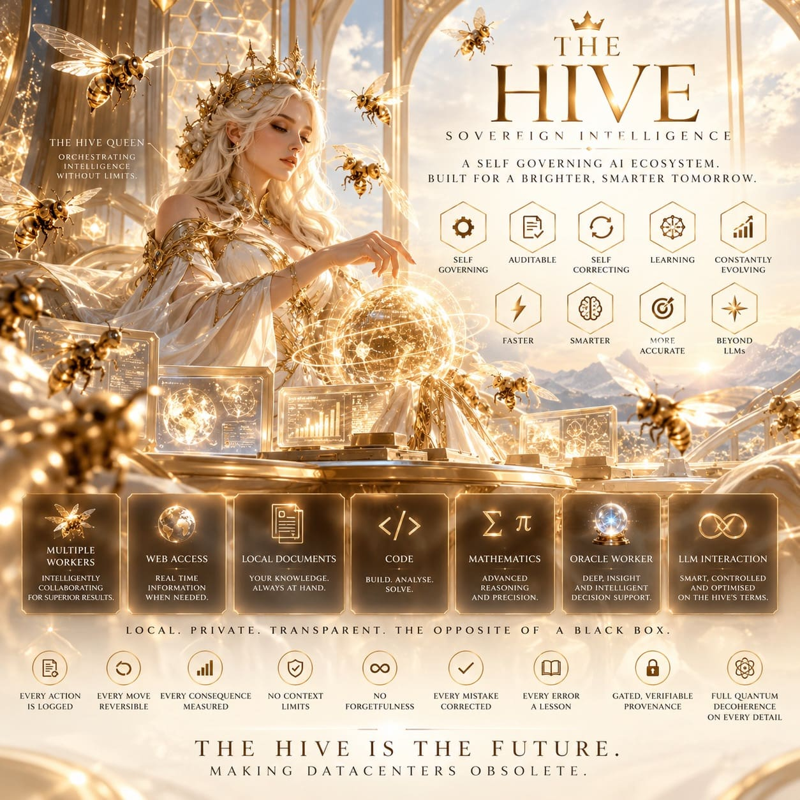

# TheHive

<p align="center">
  </p>

## Support development:

support welcome and appreciated: 
- Cashapp: $AncientMystic144 
- XMR: 44FeV38E1xVV87EaynuNkxcBpmi2G5kSE5n1wPSYjezD87MwsPckBs7SvwJmTRJ15rA3TDYSLPTpY7jyzdVTu9Sv9mtoHpi


# what the Hive is:

The Hive is a self-running learning system. a small "hive" of AI agents, supervised by one "queen." The worker agents go out and find information (from web pages, feeds, chat, local documents and their own experiments), but they're never allowed to just declare something true. Instead, they hand their findings to the queen over a queue, like interns submitting reports for review. The queen only accepts a finding if it can actually be proven: either by running it (the math works, the code passes its tests) or by checking that at least two independent sources agree.

Everything the queen accepts is written into a tamper-proof record, like a lab notebook where every page is sealed and every entry can be traced and undone. Nothing enters the book unverified, nothing hides what happened before it, and every decision is logged. On top of that, the system helps itself improve: it notices what it knows least about and goes looking for answers, it can ask an external AI for a second opinion (but only trusts that opinion after checking it), it can split a big question into small pieces handled by different workers and merge the answers back together, and it can even find and fix bugs in its own code. 

The result: a system that slowly and safely accumulates knowledge it can show its work for, and can answer your questions or do tasks in plain English while it does.

# How the hive handles data:

The core idea: a system that proves what it claims. Most knowledge or classification systems work like a labeled filing cabinet — something gets sorted into a category because a person (or a model) said so. This system refuses to do that. Every claim it makes about a math problem — "this is a combinatorics question," "this answer is correct" — comes attached to an executable check: a small piece of code that, when run, either confirms the claim or fails. If something can't be verified by running it, the system doesn't pretend it can — it openly marks that item as "not yet gradable" and keeps it visible but inactive. So nothing silent slips in: the system never rehearses confidence it can't back up.

The categories grow instead of being fixed. A traditional taxonomy is drawn up by an author once and then it's done — a static tree of labels. Here, the tree itself is manufactured. You hand the system a topic like "integer partitions" or "rational arithmetic," and it drafts a category structure for that topic — what the classes are, how they differ, what distinguishes them — and then it audits its own draft: does each class actually behave differently from its neighbors when probed? Can we distinguish real members from near-misses? Only structures that pass this earning process get used. This is why the system can cover "unbounded" territory: it isn't limited to whatever an author foresaw; it has a repeatable method for turning any new topic into a verified domain, using the same spine every time.

Classification isn't one label — it's coordinates. A problem that passes through the system isn't filed under a single name. It gets positioned along several axes at once: which domain it belongs to, how hard it is, how novel it is relative to what's already been solved. The system keeps a map of these coordinates and tracks where it has rich, verified material and where the map is empty. That's how it decides what to work on next — and that decision isn't made by a hunch, but by a small adaptive engine that weighs uncertainty, novelty, and disagreement among different internal judges.

The system also thinks about how to think — and how to heal itself. Around the classification core there's a working vocabulary of reasoning styles: worked micro-examples of how to approach proof, verification, contradiction, and uncertainty, stored so that any part of the system can borrow a proven way of thinking rather than improvising. There's also a memory of past successes and failures — what got verified, what got repaired, what fell through — kept as an append-only record so history can't be rewritten. When the system finds a bug in its own code, there's a repair lane that tries fixes and only accepts one that actually runs clean; nothing is patched in on a model's word alone.

The honest summary. Think of it as a self-auditing curriculum: it invents new subject areas, demands that every section pass an executable test before students (its own internal agents) can study it, tracks not just what's known but what's confidently unknown, schedules its own review and exploration, and keeps a tamper-proof diary of every change it makes to itself. A taxonomy is a map; this project is a surveyor that manufactures the map, tests each border point before inking it, admits the blank areas, and keeps exploring the blanks.

# Tests

```
the hive finds and fixes, not just proves

8 blind temp-file snippets, live qwen

  hive
    found:  8/8 with runtime proof
    fixed:  8/8

  Raw qwen (read only)
    found:  3/8
    fixed:  opines only, no verification
```

Note: During these tests, The Hive also found another bug in the files checked, which had been missed by multiple major online models. proving it can use a small 4B model with an intelligence score of 12.4 to beat major models scoring 40-50. it drastically improves not only performance but model intelligence as well.      
    
---

```
doing some more basic testing on the middleware api aspect of the hive 

TASK: what is 144/12
  Raw qwen: 2.99 s (token gen)
  Hive:     0.24 s — Answer (math): 144/12 = 12
  Verdict:  hive 12× faster via deterministic synth, zero tokens

TASK: formulate invitation reply
  Raw qwen: 5.25 s
  Hive:     3.8 s — packaged oracle lane
  Verdict:  hive ~1.4× faster, tightened system prompt

TASK: bug hunt mutable_state.py
  Raw qwen: 16.9 s
  Hive:     6.6 s (hive-Q, same qwen model)
  Verdict:  same findings, 2.6× faster packaging

TASK: bug hunt offbyone.py
  Raw qwen: 11.3 s
  Hive:     8.4 s
  Verdict:  same findings, faster

TASK: bug hunt none_trap.py
  Raw qwen: 9.6 s
  Hive:     9.2 s
  Verdict:  same findings

TASK: execution proofs
  Raw qwen: — (only opines)
  Hive:     3/3 fail → all bugs PROVEN by running them
  Verdict:  the gap reading can't close

TASK: fix round-trip
  Raw qwen: raw proposes fixes (2.3–5.1 s)
  Hive:     hive verifies all 3 → PASS in 0.11 s each
  Verdict:  machine-verified, not eyeballed


WHAT THIS ACTUALLY DEMONSTRATES

1. The hive wins twice over the raw model: on latency (packaged lane prompts are tighter; 
synth fast-paths skip token generation for any model callable deterministically) and on correctness 
— every verdict is a receipt on the ledger, not prose.

2. The real differentiator is execution: raw and hive-Q both read the code (same qwen weights — identical findings as expected). 
But the hive's code_run gate ran all three planted-bug snippets and produced runtime proof (pass: False) in milliseconds — 
behavior like the mutable-default state carryover is proven, not guessed. 
And when raw's fixes came back, the hive verified all three to PASS in ~0.1 s each.

3. Receipts everywhere: hive answers carry provenance; raw answers are just text.
```

---
    
